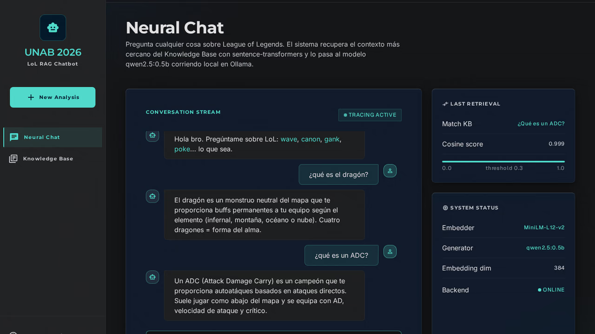
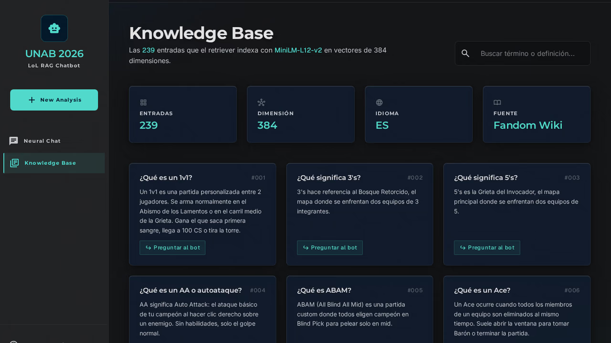
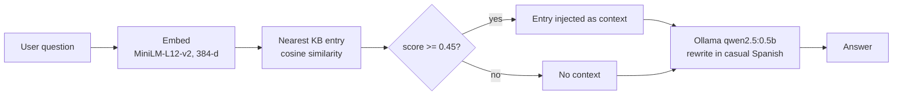

# LoL RAG Chatbot

A retrieval-augmented chatbot for League of Legends terminology: it finds the closest entry in a 239-entry Spanish glossary with sentence embeddings and has a small local LLM (Ollama) rewrite it as a casual answer.

UNAB course project (2026), Santiago, Chile. The UI, knowledge base and answers are in Spanish.





> Nota en español: proyecto del curso en la UNAB (2026). La base de conocimiento, la interfaz y las respuestas están en español. El notebook original (`lol_chatbot.ipynb`) se mantiene intacto.

## How it works



1. **Embed.** `backend/rag.py` encodes the question with `paraphrase-multilingual-MiniLM-L12-v2` (sentence-transformers, 384 dimensions). The 239 KB questions in `backend/kb.py` are embedded once at startup; the answers are not embedded.
2. **Retrieve.** The nearest KB question by cosine similarity wins (a single entry, top-1).
3. **Gate.** `backend/app.py` runs retrieval on the message alone and, when there is history, on the last two user turns plus the message, and keeps the higher score. It passes the entry to the LLM as context only if the score is at least 0.45.
4. **Generate.** A local Ollama model (`qwen2.5:0.5b`, temperature 0.3, `num_predict` 200) rewrites the entry in casual gamer Spanish, using the last 6 history turns. Prompt labels that leak into the output (`P:`, `R:`, `[CONTEXTO]`) are stripped.

### The two thresholds

| Threshold | Where | Effect |
|---|---|---|
| `0.30` | `LolRetriever(threshold=0.3)` in `backend/rag.py` | Sets `below_threshold`. With no conversation history, the app answers "No entendí esa. Pregunta algo sobre LoL bro." without calling the LLM. |
| `0.45` | `WEAK_MATCH_THRESHOLD` in `backend/app.py` | Below it, the KB entry is not given to the LLM. The model answers from the conversation alone. |

Between 0.30 and 0.45 the request still reaches the LLM, only without KB context. See [Limitations](#limitations).

### Endpoints

- `GET /health` returns `{ ok, model }`.
- `GET /kb` returns `{ count, entries }`.
- `POST /chat` takes `{ message, history }` and returns `{ reply, matched_question, matched_answer, score, below_threshold, used_context }`.

## Stack

- Backend: Python 3.14, FastAPI, sentence-transformers, httpx, managed with `uv`.
- Generation: Ollama, `qwen2.5:0.5b` (about 400 MB), running locally.
- Frontend: a single Astro page (dark UI, Tailwind through the CDN script). It pings `/health` every 15 s and keeps the last 12 messages of history.

```
backend/            FastAPI app, retriever, knowledge base
frontend/           Astro page
eval/               retrieval evaluation set, runner and results
docs/               screenshots
lol_chatbot.ipynb   original notebook (unchanged)
```

## Run it

Requirements: [`uv`](https://docs.astral.sh/uv/), Node 22.12 or later, [Ollama](https://ollama.com).

```sh
ollama pull qwen2.5:0.5b && ollama serve          # 1. model (skip `serve` if Ollama already runs)
uv sync && uv run python main.py                  # 2. backend on :8000 (first run downloads the embedding model)
cd frontend && npm install && npm run dev         # 3. frontend on :4321
```

Open <http://127.0.0.1:4321>.

Environment variables: `OLLAMA_HOST` (default `http://127.0.0.1:11434`), `OLLAMA_MODEL` (default `qwen2.5:0.5b`), and `PUBLIC_BACKEND_URL` for the frontend (default `http://127.0.0.1:8000`).

## Evaluation

`eval/questions.json` holds 30 hand-written Spanish questions: 15 in the KB but phrased differently from the entry, 8 about League but not in the KB, and 7 unrelated to League. `eval/run_eval.py` runs the retriever alone (no LLM) and applies the 0.45 gate. Single-turn only; the thresholds are reported, not tuned.

| Metric (threshold 0.45) | Result |
|---|---|
| In-KB questions: top-1 correct and accepted | 6/15 (40%) |
| League questions not in the KB: rejected | 5/8 (62%) |
| Out-of-domain questions: rejected | 7/7 (100%) |
| Sanity: a verbatim KB question returns itself | 239/239 (100%) |

| Threshold | In-KB accuracy | Not-in-KB rejected | Out-of-domain rejected |
|---|---|---|---|
| 0.30 | 6/15 | 0/8 | 1/7 |
| 0.40 | 6/15 | 3/8 | 5/7 |
| 0.45 (app) | 6/15 | 5/8 | 7/7 |
| 0.60 | 6/15 | 6/8 | 7/7 |

The gate separates unrelated questions from League questions. It does not catch wrong matches: a paraphrase such as "¿Qué es un campeón tanque?" retrieved "¿Qué es un campeón manaless?" at cosine 0.965. Full per-question table, sweep, and notes on five end-to-end `/chat` samples: [`eval/results.md`](eval/results.md).

Reproduce (needs the embedding model; add `--e2e` for the `/chat` samples when Ollama is running, and `--write` to rewrite `eval/results.md`):

```sh
uv run python eval/run_eval.py
```

## Limitations

- **Single nearest entry.** Only the top-1 KB entry is retrieved; there is no re-ranking and no multi-entry context.
- **Question-only index.** The embeddings cover the KB question text, not the answers. Short template questions ("¿Qué es un campeón X?") can match on shape instead of on the key term, and paraphrases or translations of English glossary terms (tank/tanque, stun/aturdimiento) are often missed. Top-1 on paraphrased in-KB questions was 40% in the evaluation.
- **Similarity is not correctness.** Wrong matches can score above 0.9, so a score gate cannot detect them.
- **Weak matches still get an answer.** Between 0.30 and 0.45 the LLM answers without context, and a 0.5B model will answer anything, including off-topic or false statements (in the evaluation it explained how to cook a tortilla and made claims about Ahri). Only scores below 0.30 on the first turn are refused outright.
- **Small model.** `qwen2.5:0.5b` sometimes paraphrases loosely, adds details that are not in the entry, or garbles a sentence.
- **Spanish only, glossary scope.** The KB is a glossary of terms (from the Fandom wiki). It does not cover champions, items, runes, lore, patches or match results.
- **Small evaluation.** 30 questions is a smoke test, not a benchmark.

League of Legends is a trademark of Riot Games, which is not affiliated with this project.
