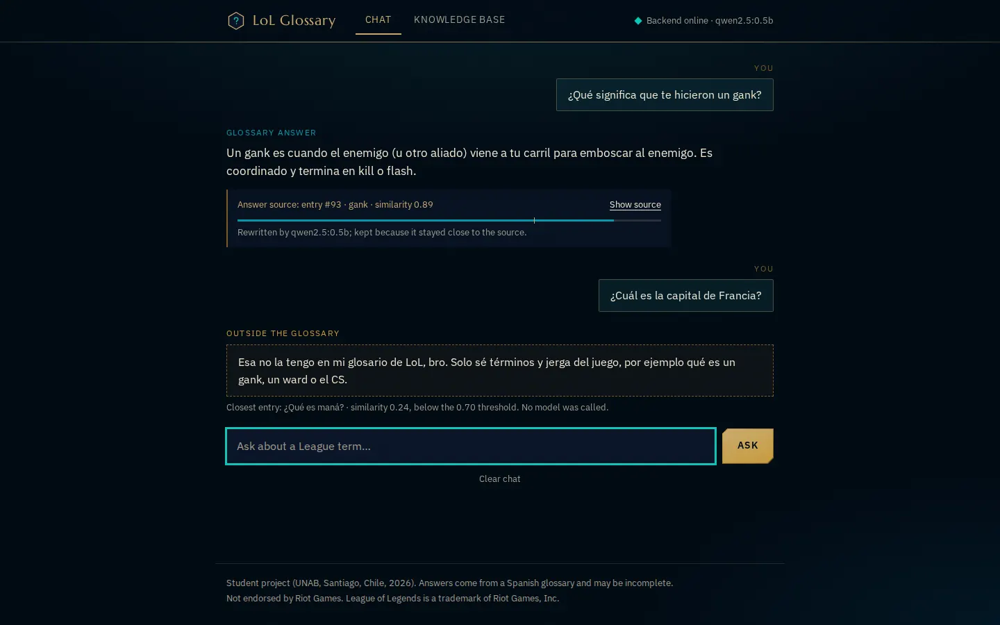
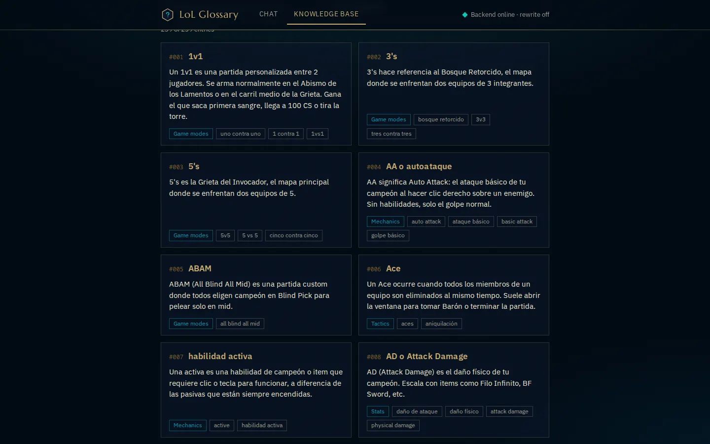
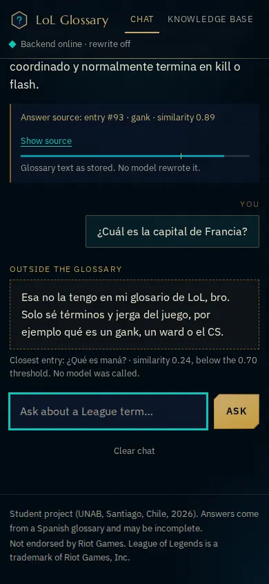
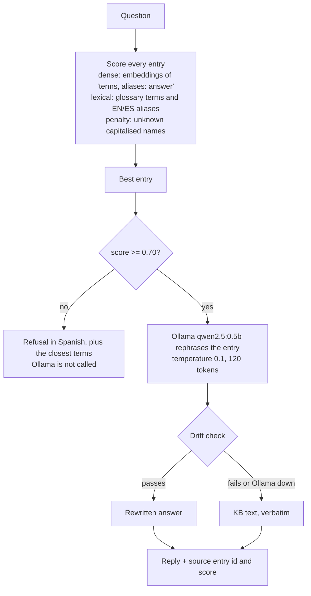

# LoL Glossary Chatbot

A retrieval-augmented chatbot for League of Legends terminology: it finds the matching entry in a 239-term Spanish glossary, refuses what the glossary does not cover, and has a small local LLM rephrase the entry only when the rephrasing stays faithful to it.

UNAB course project (2026), Santiago, Chile. The glossary and the answers are in Spanish; questions can be in Spanish or English.



<p>
  
  
</p>

> Nota en español: proyecto del curso en la UNAB (2026). La base de conocimiento y las respuestas están en español. El notebook original (`lol_chatbot.ipynb`) se mantiene intacto.

## How it works



1. **Data.** `data/kb.jsonl` is the source of truth: one entry per line with `id`, `term`, `question`, `answer`, `aliases` (English and Spanish names), `category` and `source`. `backend/kb.py` validates it with pydantic.
2. **Index.** `uv run python -m backend.ingest` normalises the text, rejects duplicate ids and questions, reports near-duplicate entries (passage cosine of at least 0.85; reported, never deleted), embeds every entry with `paraphrase-multilingual-MiniLM-L12-v2` and writes `data/index/` (embeddings plus a manifest with model, entry count and content hash). The API loads it at startup and rebuilds it if the hash does not match the data; set `LOL_INDEX_STRICT=1` to fail with the command to run instead. The index is derived (about 770 KB, tied to the model version), so it is git-ignored.
3. **Retrieve** (`backend/rag.py`). v1 embedded only the question text, so short "¿Qué es un campeón X?" questions matched on shape. Now each entry is embedded as `terms, aliases: answer`, and the query is also compared with every term and alias on its own. A lexical score (exact token, shared stem, fuzzy match, via the standard library) on those terms is added, a hubness correction lowers entries that sit close to many unrelated texts, and a capitalised name that appears nowhere in the glossary (for example a champion name) lowers the score.
4. **Gate.** Below 0.70 the chatbot answers with a fixed refusal and never calls the model. v1 only dropped the context and still let the 0.5B model answer, which is how it explained a tortilla recipe.
5. **Rephrase and check** (`backend/grounding.py`). Above the gate the model gets only the entry text and a strict prompt. Its output is kept only if it adds no numbers or names, keeps at least 80% of its content words from the entry, is not too long and is in Spanish; otherwise the reply is the entry as written. The reply says which of the two happened.

### API

- `GET /health` returns `{ ok, model, llm, entries, gate }` (`llm` is whether Ollama answers).
- `GET /kb` returns `{ count, entries }`.
- `POST /chat` takes `{ message, history }` and returns `reply`, `mode` (`rewrite`, `verbatim` or `refusal`), `reason`, `source_id`, `source_term`, `matched_question`, `matched_answer`, `score`, `gate`, `below_threshold`, `used_context` and `suggestions`. `history` is only used to resolve short follow-ups ("¿y un ejemplo?"); the model never sees it.

## Evaluation

Three sets of hand-written questions, each with three groups: in the glossary (phrased differently from the entry), about League but not in the glossary, and unrelated. All single-turn.

| Set | Questions | Role |
|---|---|---|
| `eval/questions.json` (dev) | 15 / 8 / 7 | used while building v2 |
| `eval/heldout.json` | 15 / 8 / 7 | committed before any change; only aggregates were looked at while tuning |
| `eval/fresh.json` | 10 / 6 / 6 | written after the design and gate were fixed |

Retriever and gate only (gate 0.70; v1 used 0.45 and still called the LLM):

| | in KB: correct and answered | League, not in KB: refused | unrelated: refused |
|---|---|---|---|
| dev, v1 → v2 | 6/15 → 12/15 | 5/8 → 7/8 | 7/7 → 7/7 |
| held-out, v1 → v2 | 9/15 → 14/15 | 4/8 → 4/8 | 6/7 → 7/7 |
| fresh, v1 → v2 | 6/10 → 7/10 | 2/6 → 4/6 | 3/6 → 6/6 |

Read these with care. The gate and design choices were made on dev, so dev overstates v2. Held-out was not tuned on directly, but I saw its aggregates, and after the first full run I removed ten over-generic aliases after reading failing rows, which moved it from 13/15 and 6/7 to 14/15 and 7/7; fresh is the cleanest number and has 22 questions. With samples this small a single question moves a percentage by 3 to 10 points. Also: uncovered League questions are not solved (held-out 4/8), because they share vocabulary with real entries, and some refused ones score close to the gate (dev: 0.681 and 0.689 against 0.70). [`eval/results.md`](eval/results.md) has the full before/after tables for every set, MRR, recall@3, gate precision, a gate sweep, end-to-end `/chat` results with the real model (about half of the rewrites survive the drift check), every per-question row, and these caveats in detail.

Reproduce (needs the embedding model; add `--e2e` to go through `/chat` with the model stubbed out, `--llm` to call Ollama, `--write` to rewrite `eval/results.md`, `--json out.json` for a per-question report):

```sh
uv run python eval/run_eval.py
```

## Run it

Requirements: [`uv`](https://docs.astral.sh/uv/), Node 22.12 or later, [Ollama](https://ollama.com).

```sh
ollama pull qwen2.5:0.5b          # then `ollama serve` unless Ollama already runs
uv sync                           # backend dependencies, including the embedding model runtime
uv run python -m backend.ingest   # optional: build data/index now (otherwise built on first start)
uv run python main.py             # backend on http://127.0.0.1:8000
cd frontend && npm install && npm run dev    # frontend on http://127.0.0.1:4321
```

Without Ollama the chatbot still works: answers are the glossary text as written.

Environment variables: `OLLAMA_HOST` (default `http://127.0.0.1:11434`), `OLLAMA_MODEL` (`qwen2.5:0.5b`), `CORS_ORIGINS` (comma-separated, defaults to `127.0.0.1` and `localhost` on ports 4321 and 4410), `LOL_INDEX_STRICT`, and `PUBLIC_BACKEND_URL` for the frontend (`http://127.0.0.1:8000`). The original notebook needs `uv sync --group notebook`.

## Tests

```sh
uv run pytest                     # 49 tests, no embedding model and no Ollama needed
cd frontend && npm run build
```

They cover schema validation, near-duplicate reporting, index save/load and hash-mismatch rebuild, alias matching, the gate (the mocked Ollama is never called below it), the drift fallback and the API response shape. `.github/workflows/ci.yml` runs them and the frontend build on every push and pull request.

```
backend/            app, retrieval, grounding, ingestion, schema/loader, text helpers
data/kb.jsonl       the knowledge base (data/index/ is generated)
eval/               question sets, harness, baseline numbers, results
frontend/           Astro page (plain CSS, no CDN runtime)
tests/              pytest suite
docs/               screenshots
lol_chatbot.ipynb   original notebook (unchanged)
```

## Limitations

- **Single nearest entry.** One entry is retrieved per question; there is no multi-entry context and no re-ranking model.
- **Similarity is not correctness.** A question about something the glossary only touches ("habilidad E de Ezreal", "Teamfight Tactics") can retrieve the closest generic entry and pass the gate. The source card shows what was matched, which is the mitigation, not a fix.
- **The drift check is a filter.** It catches invented numbers and names and off-topic text; a rewrite that reuses the entry's words can still be subtly wrong. About half of the rewrites are discarded, so many replies are the glossary text verbatim.
- **Aliases are hand-written** and cover the whole glossary; a generic alias can cause false matches (that is how ten were removed).
- **Gate near the boundary.** Several refused uncovered questions score within 0.05 of 0.70.
- **Follow-ups.** Conversation history only helps short follow-ups reach the right entry; the model does not see it.
- **Scope.** The glossary covers terms, not champions, items, runes, lore, patches or match results. The glossary text was compiled from the League of Legends Fandom wiki glossary; its own terms apply to that text.
- **Small evaluation.** 82 questions in total, written by hand, none from real users.

This repository does not declare a licence. League of Legends is a trademark of Riot Games; this project is not endorsed by or affiliated with Riot Games and uses none of its artwork or fonts.
